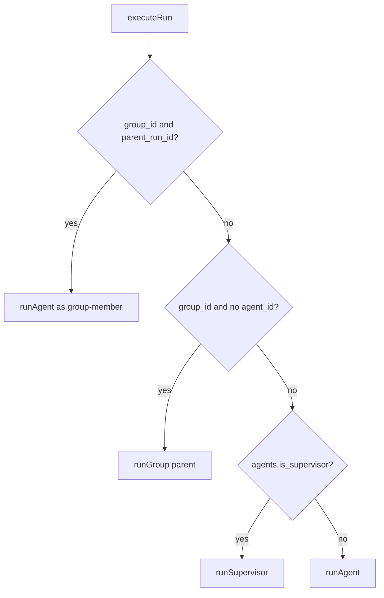
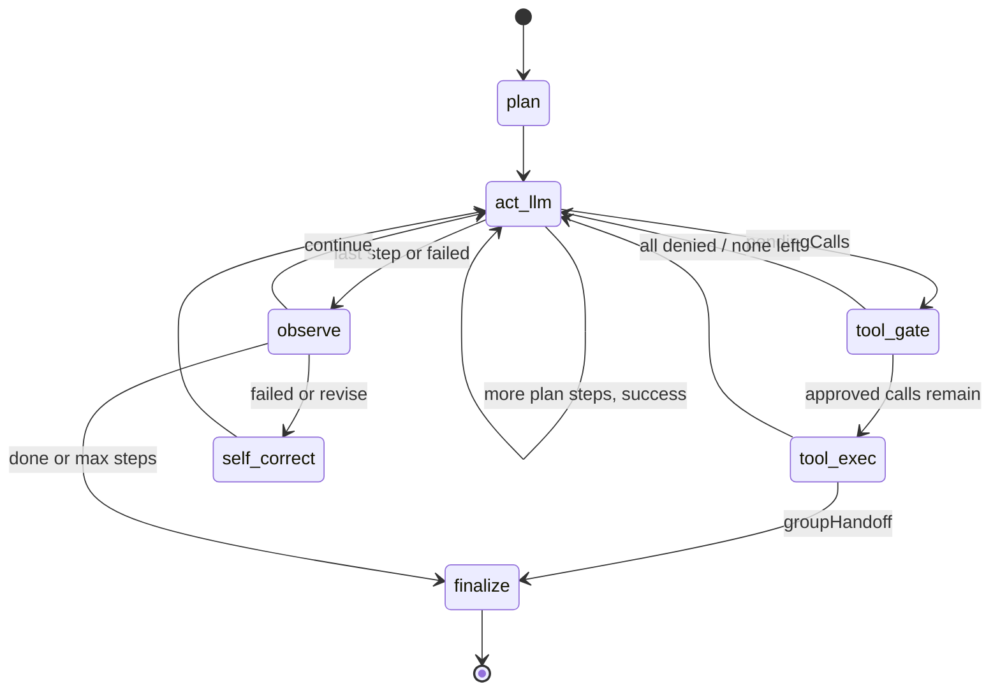
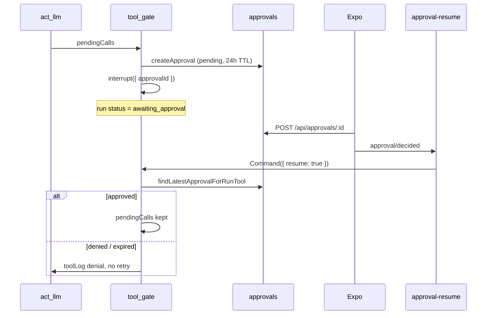
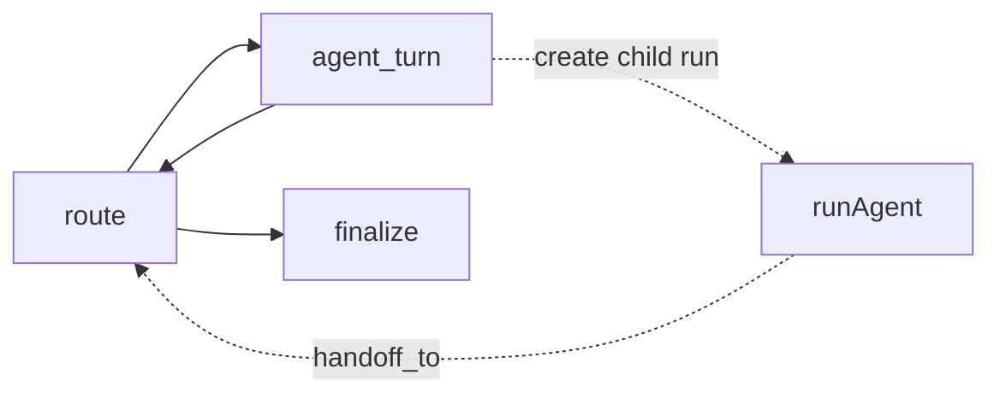
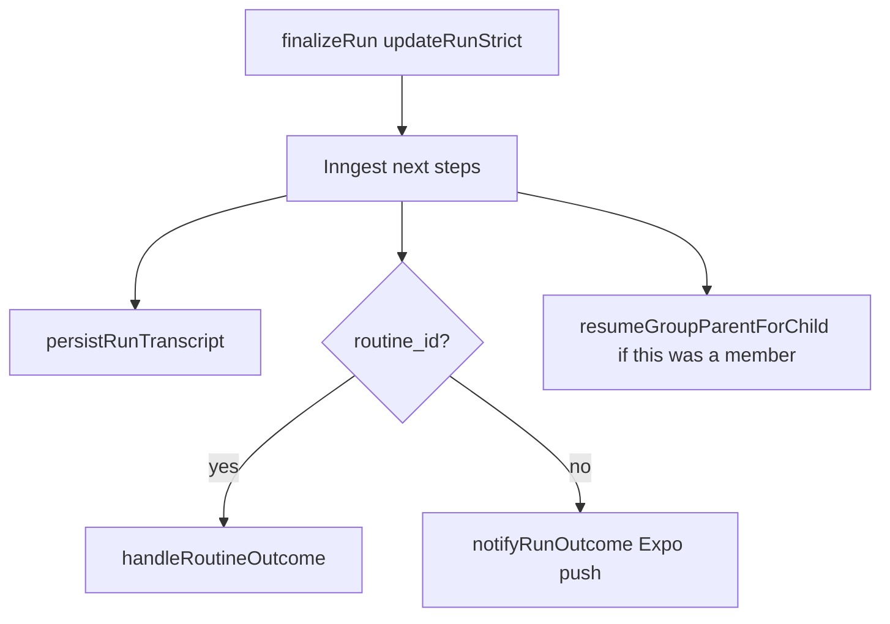

# Agent harness

Technical description of the runtime that turns a user goal into model calls, tool executions, approvals, and a durable result. Source of truth for behavior is still `docs/spec/`; this document maps that spec onto the code in `apps/api/lib/agent`, `apps/api/lib/inngest`, `apps/api/lib/mcp`, `apps/api/lib/chat`, and `apps/api/lib/models`.

---

## 1. What “harness” means here

The harness is the **server-owned control loop** around every LLM. The Expo client never calls a provider and never executes a tool. It sends a JWT, a goal (or a chat turn), and later an approval decision. Everything else is:

| Layer | Role |
|---|---|
| **Dispatch** | Pick which graph (or no graph) owns the work |
| **Model layer** | Resolve registry ids, capability-gate, fallback, usage |
| **Tool layer** | Non-executing schemas to the model; real `execute` only after a gate |
| **Graph** | Checkpointed ReAct loop (`plan → act ⇄ tools → observe`) |
| **Inngest** | Durable steps, retries, cron, resume events |
| **Persistence** | `agent_runs` / `run_events` / Postgres checkpointer / transcript |

Two execution modes share tools and models but **never share an approval path**:

1. **Ordinary chat** — request-scoped `streamText` in `POST /api/chat`. Fast, streaming, AI SDK inline approvals.
2. **Durable run** — `agent_runs` row + Inngest + LangGraph. Background, checkpointed, run-backed approvals.

```
┌──────────────┐     JWT      ┌─────────────────┐
│  Expo / web  │─────────────►│  Next.js routes │
└──────────────┘              └────────┬────────┘
                                       │
                 ┌─────────────────────┼─────────────────────┐
                 ▼                     ▼                     ▼
        POST /api/chat         POST /api/agents/run     approvals / pause
        createChatStream       createRun + Inngest      resume events
                 │                     │
                 │                     ▼
                 │              executeRun()
                 │                     │
                 │         ┌───────────┼───────────┐
                 │         ▼           ▼           ▼
                 │      runAgent   runSupervisor  runGroup
                 │         │           │           │
                 ▼         └───────────┴───────────┘
           MCP chat tools           LangGraph + PostgresSaver
           (execute bound)          (MCP declarations, no execute)
```

---

## 2. Entry points

### 2.1 Short chat (`POST /api/chat`)

- Verifies the JWT, binds the thread to an agent, loads memories/notes into the system prompt.
- Loads the agent’s MCP runtime, then **rebinds** it with `execute` for the AI SDK (`buildMcpChatTools`).
- Streams via `createChatStream` (`apps/api/lib/chat/stream.ts`).
- On finish: persist the assistant message; emit `chat/completed` for memory extraction.

Fallback is **pre-token only**. After the first content part, a 429/5xx is surfaced rather than switching models mid-reply.

### 2.2 Durable task (`POST /api/agents/run`)

1. Parse a client `idempotency-key` (UUID). Unique per user — a retry returns the existing run.
2. Insert `agent_runs` with `status = queued`.
3. Snapshot bounded prior turns into `agent_runs.thread_context`.
4. `inngest.send(agent/run.requested)`. If send fails, the run is marked `failed` so it cannot sit in `queued` forever.

```88:99:apps/api/app/api/agents/run/route.ts
async function dispatchRun(input: {
  runId: string;
  event: ReturnType<typeof agentRunRequested.create>;
}): Promise<void> {
  try {
    await inngest.send(input.event);
  } catch (error) {
    const message = error instanceof Error ? error.message : String(error);
    await failRun(input.runId, `Could not start the task: ${message}`);
    throw new Error(`Could not dispatch the run: ${message}`);
  }
}
```

### 2.3 Other triggers that reuse the same harness

| Trigger | Event / path | Notes |
|---|---|---|
| Routine tick | `routine/tick` → `agent/run.requested` | Unique `(routine_id, scheduled_for)`; inherits `approvalMode` |
| Approval decision | `approval/decided` | `resumeAgentRun` + `Command({ resume })` |
| Pause resume / wake | `run/resumed` | `invoke(null)` from checkpoint |
| Group parent after child | `resumeGroupParentForChild` | Parent stays parked while the child is on an approval |

---

## 3. Dispatch: which graph runs

`executeRun` is the single durable entry. It never imports graph internals into a route; Inngest calls this function.

```47:65:apps/api/lib/agent/execute.ts
  const kind = selectRunDispatch({
    groupId,
    parentRunId,
    agentId,
    isSupervisor,
  });
  if (kind === "group" && groupId) {
    return runGroup({ ...input, groupId });
  }
  if (kind === "group-member") {
    // A member turn is always the existing single-agent graph, even when the
    // member itself is a Supervisor agent.
    return runAgent({ ...input, approvalMode: input.approvalMode ?? "gate" });
  }
  if (kind === "supervisor") {
    return runSupervisor(input);
  }
  return runAgent(input);
```

```11:21:apps/api/lib/agent/dispatch.ts
export function selectRunDispatch(input: {
  groupId: string | null;
  parentRunId: string | null;
  agentId: string | null;
  isSupervisor: boolean;
}): RunDispatchKind {
  if (input.groupId && input.parentRunId) return "group-member";
  if (input.groupId && !input.agentId) return "group";
  if (input.isSupervisor) return "supervisor";
  return "agent";
}
```



A Supervisor agent that is a **group member** still runs `runAgent`. Supervisor children auto-deny sensitive tools; a group member must keep the human gate.

---

## 4. Durability stack

Three independent durability mechanisms stack:

```
Inngest function (retries 3, step.run)
        │
        │  if the serverless process dies mid-node
        ▼
PostgresSaver  thread_id = "agent-run-{runId}"
        │
        │  nodes wrap assertRunActive
        ▼
agent_runs.status  queued | running | awaiting_approval | paused | succeeded | failed | cancelled
```

### 4.1 Inngest function

```101:164:apps/api/lib/inngest/functions.ts
export const agentRunFunction = inngest.createFunction(
  {
    id: "agent-run",
    retries: 3,
    triggers: { event: agentRunRequested },
    onFailure: async ({ event, error }) => { /* failRun + notify */ },
  },
  async ({ event }) => {
    const result = await step.run("execute-agent-graph", () =>
      executeRun({ runId, userId, goal, preferredModel, tz, approvalMode, ... }),
    );

    if (result.status === "succeeded") {
      await step.run("persist-run-transcript", () => persistRunTranscript(runId));
    }
    // routine outcome XOR push notification
    return result;
  },
);
```

The graph writes the **answer on the run row first** (`updateRunStrict`). The transcript is a **separate idempotent step** so a DB blip retries publish, never the agent (which would re-run side-effecting tools).

`paused` / `awaiting_approval` are **success returns** from the Inngest step. `RunPausedError` / `RunCancelledError` are control flow; they must not trip `onFailure`.

### 4.2 Checkpointer

```30:60:apps/api/lib/agent/checkpointer.ts
async function init(): Promise<PostgresSaver> {
  const url = optionalEnv("DATABASE_URL");
  // ...
  const saver = new PostgresSaver(pool);
  await saver.setup();
  return saver;
}

export async function getCheckpointer(): Promise<PostgresSaver | null> {
  if (!isCheckpointerConfigured()) return null;
  holder.setupPromise ??= init().catch(/* allow retry */);
  return await holder.setupPromise;
}
```

Needs a **direct** Postgres URL (`DATABASE_URL`), not only the Supabase JS client. Missing config fails the run loudly (`checkpointer_unconfigured`).

Thread key:

```ts
{ configurable: { thread_id: `agent-run-${runId}` }, recursionLimit: 150 }
```

### 4.3 Invoke vs resume vs approval resume

| Path | Graph input | When |
|---|---|---|
| First run / Inngest retry | `{ userId, runId, goal, threadContext }` | Nodes re-run over checkpointed state |
| User pause → resume | `invoke(null)` | Re-runs the node that threw `RunPausedError` |
| Empty thread (paused before first node) | fall back to input invoke | `isEmptyThreadError` |
| Approval decided | `Command({ resume: true })` | Continues **inside** `tool_gate` |

```945:967:apps/api/lib/agent/graph.ts
export async function invokeGraph(compiled, input, resume, options) {
  const graphInput = { userId: input.userId, runId: input.runId, goal: input.goal, ... };
  if (!resume) {
    return await compiled.invoke(graphInput, options);
  }
  try {
    return await compiled.invoke(null, options);
  } catch (error) {
    if (!isEmptyThreadError(error)) throw error;
    return await compiled.invoke(graphInput, options);
  }
}
```

A pause while parked on an undecided approval **must not** `invoke(null)`: that would resume the interrupt with `undefined` and the gate would treat the still-pending row as denied. `resumeExecution` restores `awaiting_approval` instead.

---

## 5. Single-agent graph

File: `apps/api/lib/agent/graph.ts`. State: `apps/api/lib/agent/state.ts`.



### 5.1 State (checkpointed)

Reducers are chosen so retries **append** findings/tool logs and **replace** pending calls.

| Field | Purpose |
|---|---|
| `goal`, `threadContext` | User task + bounded prior turns |
| `planSteps`, `stepIndex` | 2–4 step plan from `plan` |
| `iterations` | Completed act steps; cap `MAX_AGENT_STEPS = 10` |
| `pendingCalls` | Tool calls waiting on gate / exec |
| `toolLog` | ReAct transcript for the current step |
| `roundsThisStep` | Cap `MAX_TOOL_ROUNDS_PER_STEP = 4` |
| `toolAllow` | Skill narrowing (intersection only) |
| `loadedSkills` | Trusted vault bodies for finalize (max 4) |
| `groupHandoff` | Ends the member turn immediately |
| `nextAction`, `revisionNote`, `failed`, `done`, `result` | Observe / finalize |

### 5.2 Nodes

**`plan`** — structured output, fast model chain, 2–4 sentences.

**`act_llm`** — tools are **declarations only**. `stopWhen: isStepCount(1)` so one round returns either tool calls or a step summary. No calls → finding recorded, `stepIndex++`.

**`toolsForStep`** — round 0–1: full set; later rounds: `CORE_TOOLS` (`web_search`, `fetch_page`, `search_notes`, `read_note`, `load_skill`) plus **always-on group tools**. Final round: **no tools** (forced prose). Skills can only **narrow**.

**`tool_gate`** — see §7. `interrupt()` parks the run. Resume reads the **DB approval row**, never the interrupt payload.

**`tool_exec`** — routes:

1. group tools (`handoff_to` / `ask_agent` / `post_to_group`)
2. MCP (`mcp.handles(name)` → `mcp.execute`)
3. built-ins (`executeToolCall`)

`load_skill` may set `toolAllow` and stash the body. A handoff **skips remaining calls in the same round**.

**`observe`** — `{ continue | revise | finish }`. Skipped when a successful step still has plan remaining (`routeAfterActLlm`) to save an LLM call.

**`self_correct`** — another structured “try differently” note; clears `failed`.

**`finalize`** — strongest model chain; if `groupHandoff` is set, skip the LLM and return the handoff task as the child result.

Every node is wrapped:

```303:319:apps/api/lib/agent/graph.ts
  const withPause = (nodeName, node) =>
    async (state) =>
      await measurePerf("node", nodeName, async () => {
        await assertRunActive(runId);
        return node(state);
      }, { runId, onComplete: (event) => appendPerfRunEvent(runId, event) });
```

`assertRunActive` throws `RunPausedError` / `RunCancelledError` after reading `agent_runs.status`. A transient DB error **continues** (does not kill the run). The checkpoint is **before** the throwing node, so resume re-enters that node.

### 5.3 Model chains

```84:86:apps/api/lib/agent/graph.ts
export const FAST_MODELS = [...PREPENDED_MODELS, "google:gemini-3.5-flash-lite", DEFAULT_MODEL_ID, ...DEFAULT_FALLBACK_ORDER];
export const ACT_MODELS = [...PREPENDED_MODELS, DEFAULT_MODEL_ID, ...DEFAULT_FALLBACK_ORDER];
export const FINAL_MODELS = [...PREPENDED_MODELS, "google:gemini-3.8-flash", DEFAULT_MODEL_ID, ...DEFAULT_FALLBACK_ORDER];
```

Private group turns replace these with `privateModelChain(preferred)` (Google-only) so a failover cannot leak notes/memories to Groq/OpenRouter.

`AGENT_MODELS_PREPEND` is a local escape hatch when a free tier is rate-limited.

---

## 6. Tool system

The split is the load-bearing invariant of the harness:

```
declarations  ──►  model sees schemas, no execute
executeToolCall / mcp.execute / executeGroupTool  ──►  only after the gate
```

```35:46:apps/api/lib/agent/tools.ts
 * The agent's tool layer, split in two halves:
 *
 * - `declarations` — tool schemas with NO execute function, handed to the
 *   act LLM. The model returns tool calls; the graph executes them itself
 *   in the tool-gate / tool-exec nodes, so sensitive tools can be interrupted
 *   for approval before anything runs.
 * - `executeToolCall` — the real implementations, run only by tool_exec
 *   after the gate has approved the call.
 *
 * Tool outputs are untrusted data.
```

Built-in families (all in `declarations`):

| Family | Tools | Approval |
|---|---|---|
| Web | `web_search`, `fetch_page` | no |
| Notes / memory | `search_notes`, `read_note`, `recall_memory`, `list_memories`, `save_memory` | `write_note` always |
| Canvas | `render_canvas`, `update_canvas` | spec is Zod-validated; no eval |
| Skills | `load_skill` | assigned skills only; `tools[]` intersects |
| Productivity | tasks / events / free slots | deletes always; updates if `created_by = user` |
| Routines | `create_routine`, `update_routine`, `delete_routine` | delete; create is a **draft** until HTTP activate |
| Dashboards | create/update/refresh/remove widgets | remove uses the gate |
| Group (member turns only) | `handoff_to`, `ask_agent`, `post_to_group` | target membership checked server-side |

MCP names are `mcp_<slug>_<tool>` so a remote server cannot shadow `write_note`. Cap: 20 MCP tools per run. Descriptions were sanitized at discovery; schemas go through `jsonSchema()` and are size-capped.

Ordinary chat **must not** reuse graph declarations as-is. `buildMcpChatTools` attaches `execute` and a grant consume:

```13:26:apps/api/lib/mcp/chat-tools.ts
 * The durable graph deliberately keeps MCP declarations non-executing because
 * it applies its own run-backed approval gate before calling the runtime.
 * Short chats use the same loaded runtime and policy, but need an executable
 * declaration for the AI SDK. Binding it here keeps the shared loader free of
 * an `execute` function that could accidentally bypass the graph's gate.
```

---

## 7. Approvals

Two implementations, same policy intent.

### 7.1 Durable: LangGraph interrupt + `approvals` row



Source of truth is the **row**, not `Command`’s resume value. Expired pending rows are treated as deny. `approvalMode: "deny"` (supervisor children, some routine fires) auto-denies without parking.

Sensitive set (`apps/api/lib/approvals.ts`): `write_note`, `delete_task`, `delete_event`, `delete_routine`. Conditional: `update_task` / `update_event` if the row is user-created or unverifiable.

### 7.2 Ordinary chat: HMAC + grant

1. `streamText({ toolApproval, experimental_toolApprovalSecret })` emits a signed `tool-approval-request`.
2. Client returns only the decision; signature stays in history.
3. Server verifies HMAC (`TOOL_APPROVAL_SECRET`). Missing secret → **503 fail-closed** before any thread write.
4. `chat_approval_grants` binds user, thread, agent, MCP connection, tool, input digest, expiry.
5. `execute` consumes `pending → consumed` atomically. Replay / wrong thread / connection change / expiry fail.

Signature proves **what**; the grant proves **where and once**.

---

## 8. Supervisor graph

File: `apps/api/lib/agent/supervisor.ts`.

```
START → delegate → fan_out → verify → merge → END
```

- Supervisor **does not research**. It emits briefs for specialist agents (`normalizeBriefs`: drop unknown/dupes, pad to ≥2, cap 4).
- `fan_out` creates child `agent_runs` with `parent_run_id` and **invokes `runAgent` inline** (`approvalMode: "deny"`). Idempotent: retries reuse existing children.
- `verify` prefers a model on a **different provider** than the workers (`pickCrossProviderModel`).
- `merge` writes the parent result.

Pause on a child pauses the parent at `fan_out` (`assertRunActive` + child pause cascade).

---

## 9. Group graph

File: `apps/api/lib/agent/group.ts`. Does **not** replace the supervisor.

```
START → route ⇄ agent_turn → finalize → END
```



**`route`**

- First hop: `@mention` in the goal, else lead.
- Later: pending handoff target, or next roundtable member, or stop (`handoff_complete` / `roundtable_complete`).
- Guardrails: `maxHops`, token budget, A→B→A→B ping-pong, sleeping members, invalid targets.

**`agent_turn`**

- Creates (or reuses, on Inngest retry) a **child run** of `runAgent` with `groupContext`.
- Child gets a compact brief + rolling summary, **not** the full transcript.
- `private_ok` false → strip note/memory context and retrieval tools; Google-only fallback.
- Privacy is the **caller’s** policy: a private-capable member cannot hand off or consult a non-private member (copying private facts into prose is indistinguishable from ordinary text).
- Nested `ask_agent` depth capped (`maxDepth: 2`).

**Approvals:** child parks → parent `awaiting_approval`. After `approval/decided`, child resumes from its checkpoint, then `resumeGroupParentForChild` continues the parent. On resume, **live group membership** is re-read; persisted `group_context` is not trusted for identity or privacy.

One live parent run per group (409). Ordinary `/api/chat` on a group thread is 409 `group_thread`.

---

## 10. Pause, cancel, sleep

| API | Effect |
|---|---|
| `POST /api/runs/:id/pause` | `status = paused`; cascades unfinished supervisor children |
| `POST /api/runs/:id/resume` | `run/resumed` → `beginResume` (`paused → running`) → `executeRun({ resume: true })` |
| `POST /api/runs/:id/cancel` | terminal; resume is a no-op |
| `POST /api/agents/:id/sleep` | `agents.sleeping`; pauses active runs; new runs 409 |
| `POST /api/agents/:id/wake` | clears flag; re-emits `run/resumed` including supervisors waiting on children |

`beginResume` is re-entrant: concurrent resume paths may already have flipped to `running`.

---

## 11. Model layer (shared by chat and graphs)

All calls go through `getModel` / `withFallback` / `generateTextWithFallback` (`apps/api/lib/models`). Never a provider SDK from a route.

Order:

1. Registry lookup + `assertCapabilities` (vision, tools, structured output, `private_ok`).
2. Resolve API key; skip if missing.
3. Call; on 429/5xx retry once on the **same** model, then next id.
4. `provider_usage` row.

Chat streaming uses the same capability gate but stops fallback after first token (`createChatStream`).

---

## 12. Side effects after a successful graph



- Transcript message id = run id (idempotent upsert).
- Group/child/routine runs often **own their own** transcript path; the ordinary persist step is a no-op for them.
- Top-level non-routine runs push on success/failure. Nested supervisor/member runs do not.
- Tokens on a parked run are **additive** across resume (`persistedTokensUsed + usage.total()`), so group budgets cannot under-count.

---

## 13. Event catalog (harness-related)

Defined in `apps/api/lib/inngest/events.ts`:

| Event | Function | Job |
|---|---|---|
| `agent/run.requested` | `agent-run` | `executeRun` |
| `approval/decided` | `approval-resume` | `resumeAgentRun` + parent resume |
| `run/resumed` | `run-resumed` | `resumeExecution` |
| `chat/completed` | `chat-completed-memory` | `extractMemories` |
| `vault/changed` | `vault-changed-sync` | notes + skills index |
| `dashboard/refresh.requested` | dashboard worker | no LLM; mapped sources only |
| crons | `routine/tick`, `reminder/tick` | schedule / push |

---

## 14. File map

```
apps/api/lib/agent/
  execute.ts          dispatch + pause-resume policy
  dispatch.ts         pure graph picker
  graph.ts            single-agent StateGraph
  state.ts            AgentState annotations + caps
  supervisor.ts       delegate / fan_out / verify / merge
  group.ts            route / agent_turn / finalize
  tools.ts            builtin declarations + executeToolCall
  checkpointer.ts     PostgresSaver singleton
  pause.ts            assertRunActive, beginResume
  runs.ts             agent_runs + run_events
  run-persistence.ts  transcript after the answer exists
  thread-context.ts   bounded prior turns
  idempotency.ts      start-task key
  sleep.ts            agent sleep/wake
  notifications.ts    Expo push

apps/api/lib/inngest/{client,events,functions}.ts
apps/api/lib/mcp/{tools-loader,chat-tools}.ts
apps/api/lib/chat/{stream,approval-grant}.ts
apps/api/lib/approvals.ts
apps/api/lib/models/{fallback,generate,registry,capability}.ts
apps/api/app/api/agents/run/route.ts
apps/api/app/api/chat/...
```

---

## 15. Invariants (when changing the harness)

1. **Declarations never execute.** If you add `execute` on a graph tool, you bypass `tool_gate`.
2. **Chat MCP execute is a separate binder** (`buildMcpChatTools`). Do not fold it into `loadAgentMcpTools`.
3. **Parked statuses are not failures.** Catch `RunPausedError`, `RunCancelledError`, and LangGraph interrupts; return them so Inngest does not `failRun`.
4. **Answer then transcript.** Never write the chat row as the only copy of the result.
5. **Group member ≠ supervisor graph.** Dispatch must stay `group-member` → `runAgent`.
6. **Approval resume reads the DB row.** Do not trust `Command` payload for allow/deny.
7. **Pause + pending approval:** restore `awaiting_approval`; do not `invoke(null)`.
8. **Skills only narrow.** Intersection of current ∩ available ∩ declared.
9. **Tool output is untrusted.** It must not change the allow-list except via the explicit `load_skill` intersection.
10. **Private context stays on `private_ok` chains.** Group handoff/consult to a non-private target is refused, not sanitized.

---

## 16. Typical single-agent timeline (`run_events`)

```
queued
node_start plan
node_end   plan { plan: [...] }
node_start act_llm { round: 1 }
node_end   act_llm { calls: ["web_search"] }
node_start tool_gate
tool_call  write_note  → awaiting_approval   (if sensitive)
           ─ user decides ─
node_end   tool_gate
node_start tool_exec
node_end   tool_exec
node_start act_llm { round: 2 }   (or observe / finalize)
...
status = succeeded  result.answer = ...
persist-run-transcript
```

That sequence is what the mobile run timeline renders; nodes also emit `perf` events for latency (`appendPerfRunEvent`).
