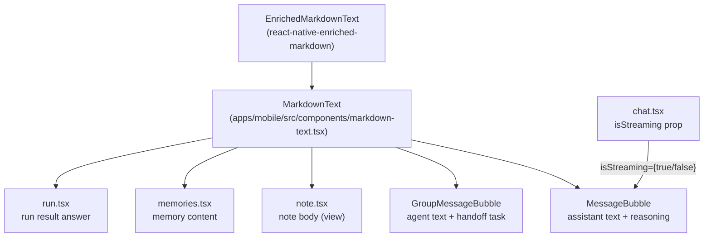

# Implement react-native-enriched-markdown Throughout the App

## Goal

Replace every plain `<Text>` node that renders AI-generated or Markdown-formatted content with `EnrichedMarkdownText` from **`react-native-enriched-markdown`** (Software Mansion). This gives the app:
- Native (non-WebView) rendering of bold/italic/headers/code/tables/lists
- Smooth **streaming** token fade-in during live AI responses (the `streaming` prop)
- Code-block syntax highlighting (opt-in at build time)
- Link detection and `onLinkPress` support

> [!NOTE]
> `react-native-streamdown` has been **merged into** `react-native-enriched-markdown` as of recent releases. You **do not** need to install a separate `react-native-streamdown` package. The `streaming` prop on `EnrichedMarkdownText` handles real-time LLM token streaming natively.

---

## User Review Required

> [!IMPORTANT]
> **New Architecture required.** `react-native-enriched-markdown` requires Expo's New Architecture (Fabric). Your `app.json` doesn't yet set `newArchEnabled: true` — it must be added, and the app **must be run as a development build** (`npx expo run:ios` / `npx expo run:android`). It will not work in Expo Go.

> [!WARNING]
> **A native rebuild is mandatory after installation.** The library ships a native C parser (`md4c`) and Fabric components. After `npm install`, you must run `npx expo run:ios` and `npx expo run:android` to trigger a full native rebuild. No OTA update will carry these changes.

> [!CAUTION]
> **The skill editor's markdown textarea (`apps/mobile/src/app/skills/[id].tsx`) must NOT be changed to `EnrichedMarkdownText`** — it's a raw text input, not a renderer. I will leave that as a `TextInput`.

---

## Open Questions

> [!IMPORTANT]
> 1. **Code-block syntax highlighting** — do you want it enabled? It significantly increases binary size (downloads tree-sitter grammars during `npm install`). I'll plan for `enableCodeHighlight: true` with `["javascript", "typescript", "tsx", "python", "bash"]` by default — let me know if you want fewer/more languages or to disable it entirely.
> 2. **Math/LaTeX** — `enableMath` can render LaTeX. Do you need this? I'll default to `false`.
> 3. **Custom link handling** — the current app uses `Linking.openURL`. Should tapped links open in the in-app `expo-web-browser` instead?

---

## Markdown Surfaces Found in the App

| Surface | File | Current render | Should use markdown? |
|---|---|---|---|
| **Assistant chat bubble text** | `components/message-bubble.tsx` | `<Text>` | ✅ Yes — with `streaming` prop |
| **Reasoning trace (expanded)** | `components/message-bubble.tsx` | `<Text>` | ✅ Yes (non-streaming) |
| **Group assistant bubble** | `components/group-message-bubble.tsx` | `<Text style={agentText}>` | ✅ Yes |
| **Note body (view mode)** | `app/note.tsx` | `<Text>` | ✅ Yes |
| **Memory content** | `app/memories.tsx` | `<Text>{memory.content}</Text>` | ✅ Yes |
| **Run result / answer** | `app/run.tsx` | `<Text>` (line 324) | ✅ Yes |
| **Handoff task description** | `components/group-message-bubble.tsx` | `<Text>` | ✅ Yes (brief inline) |

Surfaces that **stay as plain `<Text>`** (they are UI labels or user-typed raw text, not Markdown):
- Run goal text, status labels, agent names, timestamps, error messages, header titles
- `skills/[id].tsx` instruction body — it's a `TextInput` (edit mode)

---

## Proposed Changes

### 1. Package Installation & Native Config

#### [MODIFY] `apps/mobile/package.json`
Add the library (and optionally configure it):

```json
// In the "dependencies" block:
"react-native-enriched-markdown": "latest"
```

Add a top-level feature config key:

```json
{
  "enriched-markdown": {
    "enableMath": false,
    "enableCodeHighlight": true,
    "codeHighlightLanguages": ["javascript", "typescript", "tsx", "python", "bash", "json"]
  }
}
```

#### [MODIFY] `apps/mobile/app.json`
Enable the New Architecture:

```diff
 "experiments": {
   "typedRoutes": true,
-  "reactCompiler": true
+  "reactCompiler": true,
+  "newArchEnabled": true
 }
```

---

### 2. Shared Markdown Component

#### [NEW] `apps/mobile/src/components/markdown-text.tsx`

A thin, themed wrapper so we have a **single import** throughout the app:

```tsx
import React from 'react';
import { StyleSheet } from 'react-native';
import { EnrichedMarkdownText } from 'react-native-enriched-markdown';
import * as Linking from 'expo-linking';
import { colors } from '@/theme';

type Props = {
  /** Raw markdown string */
  markdown: string;
  /** Pass true while the LLM is still streaming tokens */
  streaming?: boolean;
  /** Override text size (default: 17) */
  fontSize?: number;
  /** Override text color */
  color?: string;
  onStreamingEnd?: () => void;
};

/**
 * App-wide Markdown renderer using react-native-enriched-markdown.
 *
 * - Automatically picks up the app color theme.
 * - Pass `streaming={true}` while an AI response is in-flight
 *   so incomplete syntax (open code fences, bold markers, etc.)
 *   is hidden until the stream closes.
 */
export function MarkdownText({
  markdown,
  streaming = false,
  fontSize = 17,
  color = colors.textPrimary,
  onStreamingEnd,
}: Props) {
  return (
    <EnrichedMarkdownText
      markdown={markdown}
      streaming={streaming}
      onStreamingEnd={onStreamingEnd}
      onLinkPress={({ url }) => void Linking.openURL(url)}
      textStyle={{ fontSize, lineHeight: fontSize * 1.35, color }}
      codeBlockStyle={styles.codeBlock}
      inlineCodeStyle={styles.inlineCode}
    />
  );
}

const styles = StyleSheet.create({
  codeBlock: {
    backgroundColor: colors.surfaceRaised,
    borderRadius: 8,
  },
  inlineCode: {
    backgroundColor: colors.surfaceRaised,
    borderRadius: 4,
    paddingHorizontal: 4,
  },
});
```

---

### 3. Chat Bubbles — `message-bubble.tsx`

#### [MODIFY] `apps/mobile/src/components/message-bubble.tsx`

**Key change:** The `MessageBubble` component receives a new optional `isStreaming` prop. This is threaded down from the chat screen's `status` value.

```diff
+import { MarkdownText } from '@/components/markdown-text';

 type Props = {
   role: 'user' | 'assistant' | 'system' | 'tool';
   parts: { type: string; [key: string]: unknown }[];
   modelLabel?: string | null;
   agent?: AgentSummary | null;
   runId?: string | null;
   onViewTask?: (runId: string) => void;
   onEditRoutine?: (routineId: string) => void;
   replyQuote?: string | null;
   onSelectOption?: (option: string) => void;
+  isStreaming?: boolean;   // ← new: true while AI is mid-stream
 };
```

Assistant text part (the main rendering change — replace the `<Text>` with `<MarkdownText>`):

```diff
 // Inside the parts.map — 'text' type, non-question branch:
-return (
-  <Text
-    key={index}
-    style={{ fontSize: 17, lineHeight: 22, fontWeight: '400', color: colors.textPrimary }}
-  >
-    {textContent}
-  </Text>
-);
+return (
+  <MarkdownText
+    key={index}
+    markdown={textContent}
+    streaming={isStreaming}
+  />
+);
```

Reasoning trace (non-streaming, smaller font):

```diff
-<Text style={{ fontSize: 13, lineHeight: 18, color: colors.textSecondary }}>
-  {text}
-</Text>
+<MarkdownText markdown={text} fontSize={13} color={colors.textSecondary} />
```

User bubbles stay as plain `<Text>` — user messages are not markdown.

---

### 4. Group Message Bubble — `group-message-bubble.tsx`

#### [MODIFY] `apps/mobile/src/components/group-message-bubble.tsx`

```diff
+import { MarkdownText } from '@/components/markdown-text';

 // agent bubble text:
-<Text style={styles.agentText}>{text}</Text>
+<MarkdownText markdown={text} />

 // handoff task description (small text):
-<Text style={styles.handoffTask}>{message.handoff.task}</Text>
+<MarkdownText markdown={message.handoff.task} fontSize={13} color={colors.textSecondary} />
```

---

### 5. Note Screen — `app/note.tsx`

#### [MODIFY] `apps/mobile/src/app/note.tsx`

The view mode shows raw note content. Notes are stored as Markdown (`.md` files in the GitHub vault), so render them properly:

```diff
+import { MarkdownText } from '@/components/markdown-text';

 // Note Body — view mode only (edit mode stays as TextInput)
-<Text style={styles.noteBodyText}>
-  {note.content}
-</Text>
+<MarkdownText markdown={note.content} />
```

---

### 6. Memories Screen — `app/memories.tsx`

#### [MODIFY] `apps/mobile/src/app/memories.tsx`

```diff
+import { MarkdownText } from '@/components/markdown-text';

-{memory.content}  // inside a <Text>
+<MarkdownText markdown={memory.content} fontSize={15} />
```

---

### 7. Run Screen — `app/run.tsx`

#### [MODIFY] `apps/mobile/src/app/run.tsx`

The final `answer` from a completed run is an AI-generated Markdown string:

```diff
+import { MarkdownText } from '@/components/markdown-text';

-<Text style={{ fontSize: 16, lineHeight: 22, color: colors.textPrimary }}>
-  {answer}
-</Text>
+<MarkdownText markdown={answer} fontSize={16} />
```

---

### 8. Wire up `isStreaming` in the chat screen

#### [MODIFY] `apps/mobile/src/app/(tabs)/chat.tsx`

Pass the streaming state through to `MessageBubble`:

```diff
 // Already computed on line 218:
 const isStreaming = status === 'streaming' || status === 'submitted';

 // Inside the messages.map / MessageBubble usage:
 <MessageBubble
   ...
+  isStreaming={isStreaming && index === messages.length - 1}
 />
```

This ensures only the **last** (in-flight) message gets the streaming fade-in; older messages render immediately.

---

## Component Relationship



---

## Verification Plan

### Installation commands
```bash
# From the repo root
npm install react-native-enriched-markdown
# Trigger native rebuild
npx expo run:ios     # or npx expo run:android
```

### Automated Tests
```bash
# TypeScript – no new type errors
cd apps/mobile && npx tsc --noEmit
# ESLint
cd apps/mobile && npx expo lint
```

### Manual Verification

1. **Chat streaming** — send a message with markdown in the response (e.g., "Give me a numbered list with code examples"). Verify:
   - Text fades in token-by-token while streaming
   - Bold, italic, code blocks, headers all render correctly once complete
2. **Note view** — open a note with headers and bullet points. Verify rendered as formatted markdown, not raw text.
3. **Memory** — if any memory contains bold/italic, verify it renders.
4. **Run result** — trigger an agent run, wait for `succeeded`. Open the run screen and verify the `answer` field is formatted.
5. **Group chat** — verify group agent bubbles render markdown correctly.
6. **No regression** — user bubbles must still render as plain text (not markdown).
7. **Link press** — verify tapping a URL in a markdown response opens it via `Linking.openURL`.
